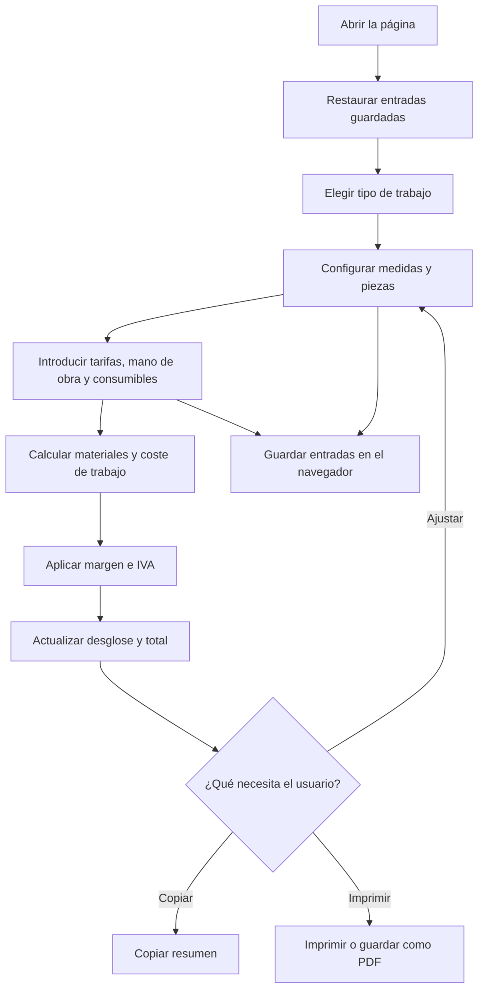

# Flujo de la aplicación

### Secuencia de cálculo

1. Al abrir la página, se intentan recuperar las entradas anteriores desde `localStorage` —el almacenamiento del navegador— y se calcula el resumen inicial.
2. El usuario selecciona línea completa, tramo intermedio o tramo final. La pantalla muestra las opciones que corresponden a ese tipo.
3. Cada cambio en un campo dispara `calc()`: calcula materiales, consumibles y mano de obra, y luego añade margen e IVA.
4. La función actualiza el desglose y el total, construye el texto breve para cliente y guarda las entradas actuales.
5. El usuario puede copiar el resumen, imprimirlo o reiniciar el formulario. El navegador conserva los parámetros hasta que se limpian con **Nuevo**.

